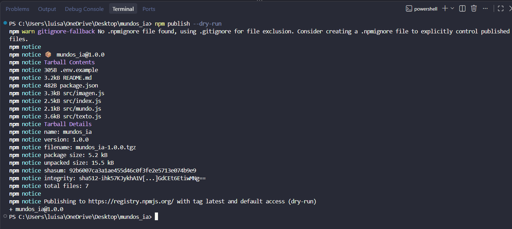
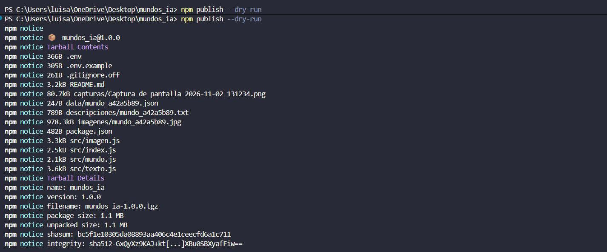
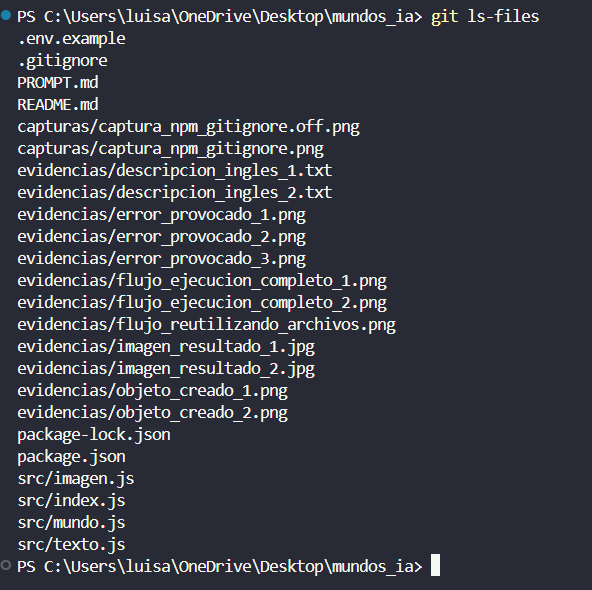

# mundos-ia

Programa de consola en Node.js para crear mundos imaginarios, generar descripciones artísticas detalladas con modelos de lenguaje y producir imágenes a partir de esas descripciones mediante Inteligencia Artificial.

---

## Servicios Utilizados

* **Generación de texto (Prompt):** [Groq Cloud](https://console.groq.com/)  
  Utiliza el modelo rápido `llama-3.3-70b-versatile` para transformar la situación, el tipo de mundo y los colores en un prompt visual detallado en inglés.
* **Generación de imágenes:** [Cloudflare Workers AI](https://developers.cloudflare.com/workers-ai/)  
  Utiliza el modelo `@cf/black-forest-labs/flux-1-schnell` para procesar la descripción y generar una imagen artística en formato JPG de alta calidad.

---

## Requisitos Previos

* Node.js v20.6.0 o superior (compatible con `fetch` nativo y `process.loadEnvFile`).
* Dependencia `object-hash` instalada.

---

## Configuración

1. Instala las dependencias del proyecto:
   ```bash
   npm install
   ```

2. Copia la plantilla de variables de entorno a un archivo `.env`:
   * En Windows (PowerShell):
     ```powershell
     Copy-Item .env.example .env
     ```
   * En Linux / macOS / Bash:
     ```bash
     cp .env.example .env
     ```

3. Abre el archivo `.env` y coloca tus claves de acceso:
   ```env
   GROQ_API_KEY=tu_api_key_de_groq_aqui
   CLOUDFLARE_ACCOUNT_ID=tu_account_id_de_cloudflare_aqui
   CLOUDFLARE_API_TOKEN=tu_api_token_de_cloudflare_aqui
   ```

---

## Modo de Uso

Ejecuta el programa pasando entre comillas la **situación**, el **tipo de mundo** y **exactamente 5 colores**:

```bash
node src/index.js "Un bosque mágico iluminado por luciérnagas" "Fantasía mística" "verde" "marrón" "dorado" "azul" "violeta"
```

### Flujo de Ejecución:
1. **Paso 1:** Genera un identificador único de 8 caracteres a partir de los datos y guarda la configuración en `data/mundo_<id>.json`.
2. **Paso 2:** Envía los datos a Groq y almacena la descripción en `descripciones/mundo_<id>.txt` (si ya existe localmente, se reutiliza sin gastar peticiones).
3. **Paso 3:** Envía la descripción a Cloudflare Workers AI y guarda la imagen en `imagenes/mundo_<id>.jpg` (si ya existe localmente, se reutiliza).

---

## Estructura de Carpetas

```text
mundos_ia/
├── .env.example               # Plantilla de variables de entorno
├── .gitignore                 # Reglas de exclusión para Git
├── package.json               # Configuración y dependencias de npm
├── README.md                  # Documentación del proyecto
├── src/
│   ├── index.js               # Punto de entrada y orquestador del programa
│   ├── mundo.js               # Cálculo de id con hash, creación y guardado del JSON
│   ├── texto.js               # Conexión nativa con la API de Groq
│   └── imagen.js              # Conexión nativa con la API de Cloudflare Workers AI
├── data/                      # Archivos mundo_<id>.json generados localmente
├── descripciones/             # Archivos mundo_<id>.txt con descripciones generadas
└── imagenes/                  # Archivos mundo_<id>.jpg con las imágenes creadas
```

## Experimento Gitignore

Ejecuté ```bash npm publish --dry-run``` usando el nombre del archivo .gitignore y al ejecutarse salió lo siguiente:



Como se puede ver la imagen el comando responde con el mensaje de que no se encontró un archivo llamado .npmignore usando gitignore para excluir archivos, esto es muy importante porque si usamos el gitignore.off se ejecuta lo siguiente:



Aquí no sale el mensaje y lo peligroso es que no excluye archivos para publicar el paquete en npm, por lo que se nos van a subir las API KEY y como estoy usando CloudFlare a parte de subirse la API KEY también lo hará mi id de mi cuenta con la que estoy registrado en este servicio, esto puede hacer que un atacante pueda agotar mis cuotas de uso de IA en cualquier cosa que se le ocurra, incluso generando facturas a mi costa por el uso de IA, y como tengo el ID de mi cuenta puede robar información, alterar registros, etc.. Por esto, es muy peligroso subir esta información a repositorios públicos donde cualquier persona los puede ver y usar.


## Pruebas del Gitignore

El comando ```bash git ls-files``` nos lista los archivos que esán en nuestro repositorio y podemos ver que no se están subiendo carpetas ni archivos locales, como nuestras imágenes, descripciones y nuestra carpeta data, ni tampoco se está subiendo el arhivo .env con las variables de entorno que son las API KEY y el ID de mi cuenta de CloudFlare



## Respuestas de la Reflexión

**1. ¿Por qué el id se calcula sin la fecha? ¿Qué pasaría si la incluyeras?**

> El Id se calcula sin la fecha porque como el id se crea con las propiedades del objeto, si añadimos la fecha, a la hora de crear el id va a ocurrir que al ejecutar el mismo comando con las mismas propiedades tenga un id distinto, porque se creó en una hora distinta. Entonces, el programa podría hacer una y otra vez la misma petición teniendo los mismos valores, por lo que se podrían acabar nuestros tokens y no tendríamos la verificación de si ya existe un objeto con ese id porque nunca habrían dos iguales.

**2. ¿Por qué se le pide al modelo de texto la descripción en inglés? Si puedes, prueba con una en español y compara las imágenes.**

> Estuve investigando y es porque los modelos de IA fueron entrenados en su gran mayoría con imágenes que tenían sus textos descriptivos en inglés, entonces entienden mejor a lo que se refieren los adjetivos en inglés. En español pueden llegar a confundir tonalidades de colores, no entender términos artísticos y al confundirlos los ignoran, entonces en inglés suelen ser más precisos y crean mejores imágenes.

**3. ¿Qué diferencia hay entre una respuesta JSON de texto y una respuesta con los bytes de una imagen? ¿Qué es base64?**

> La diferencia clara es el contenido, cuando una API nos responde un JSON nos responde un texto que ya está en una estructura clave-valor ```{"mensaje": "hola"}``` que podemos convertir en un objeto con el método ```.json()```. Cuando nos responden con una imagen la respuesta es una secuencia de bytes que contiene la información de la imagen, Base64 es un método de condificación que convierte esos datos que vienen en la secuencia de bytes a una cadena de texto, así podemos agregar una imagen como texto a una propiedad de un JSON.

**4. ¿Qué pasaría si guardas la imagen con 'utf-8'? ¿Por qué?**

> Porque utf-8 es una codificación para texto por lo que al intentar almacenar una imagen con esta codificación van a surgir errores por tratar de convertir información que representa datos de una imagen a texto, puede que transforme información o que no deje porque algunos valores son inválidos y la imagen se corrompa por pérdida de información y luego no se pueda abrir.

**5. ¿Qué pasos consumen cuota gratuita y cómo evitaste repetirlos?**

> Paso 2: Porque hace una petición a Groq en la que le manda información y espera una respuesya y esto consume tokens.
>
> Paso 3: Por lo mismo, hace una petición pero ahora a CLoudeflare que a partir del mensaje crea una imágen consumiendo poder de cómputo y disminuye la cuota diaria.
>
> El programa evita hacer llamados que ya fueron realizados usando la propiedad id del objeto, porque constrímos el id a base de las propiedades del objeto sin tener en cuenta la propiedad creadoEn. Antes de hacer el fetch a Groq comprueba si el archivo con id creado a partir de las propiedades ya existe en la carpeta descripciones y si ya existe simplemente lo lee con fs.readFileSync y no gasta ninguna petición a la API. Y cuando llega la hora de hacer la petición a CloudFlare en el archivo imagen.js, verifica si ya existe la imagen con el id determinado y si si existe no hace el llamado a la API.

**6. Si usaste IA: ¿qué fue lo más difícil de pedirle y qué parte tuviste que corregir tú?**

> Lo más difícil fue la configuración de las API KEY porque aquí la IA no me puede ayudar solo deja el programa preparado para usar la API KEY pero no me ayuda a configurarlas y la de Groq fue muy fácil pero la de CloudFlare tenía configuraciones raras para el usuario, y obviamente uno no debería mostrar esa parte de configuración del proyecto a la IA por seguridad, entonces toca usar el traductor. Y la parte que yo corregí fue que la IA usó en el fetch de la descripción un modelo de IA que mi cuenta no tiene disponible, por lo que tocó cambiarlo manualmente por uno que si tuviera disponible y se le añadió una variable de entorno para cambiar entre modelos mucho más sencillo. 